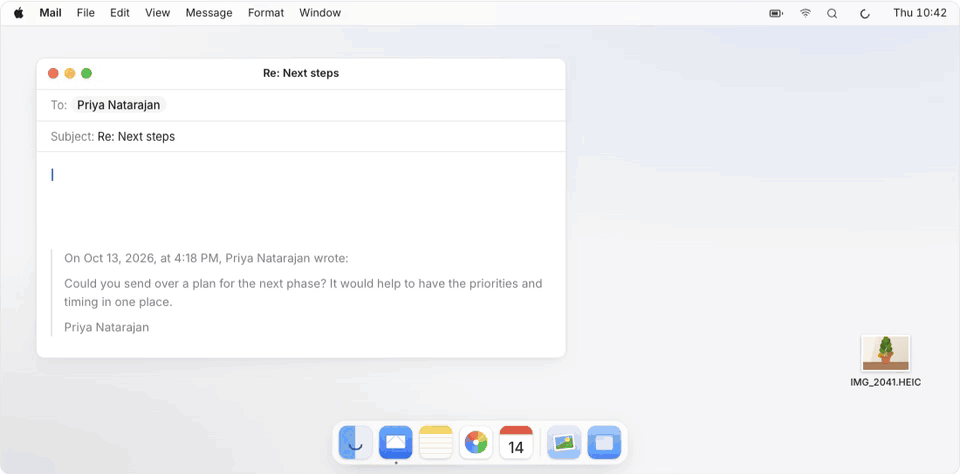
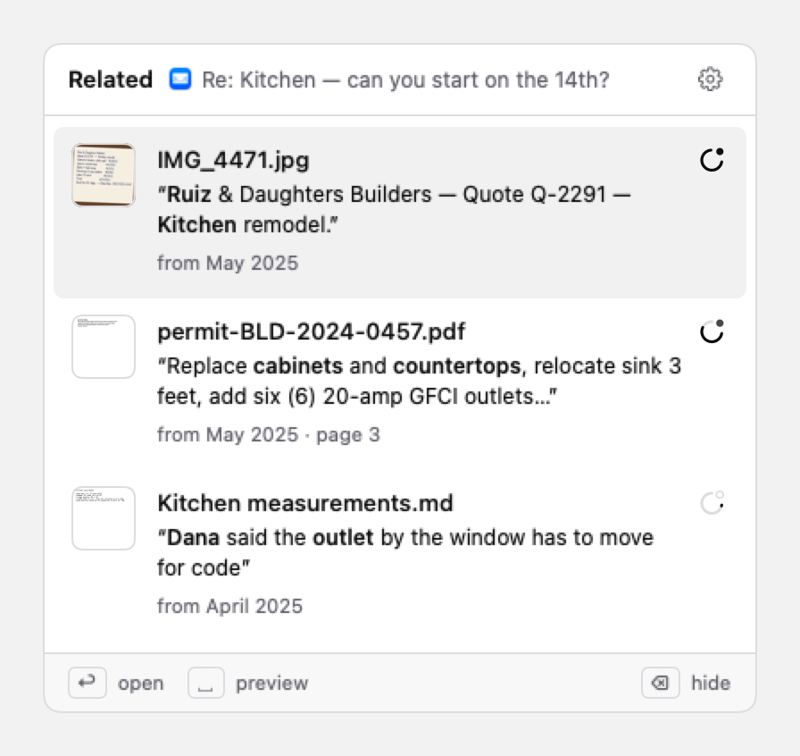
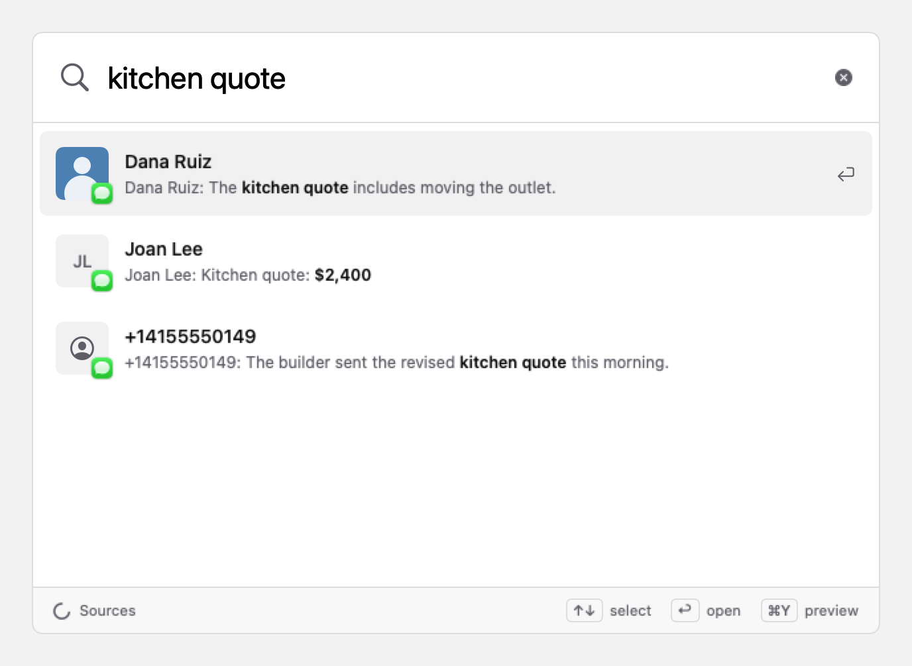
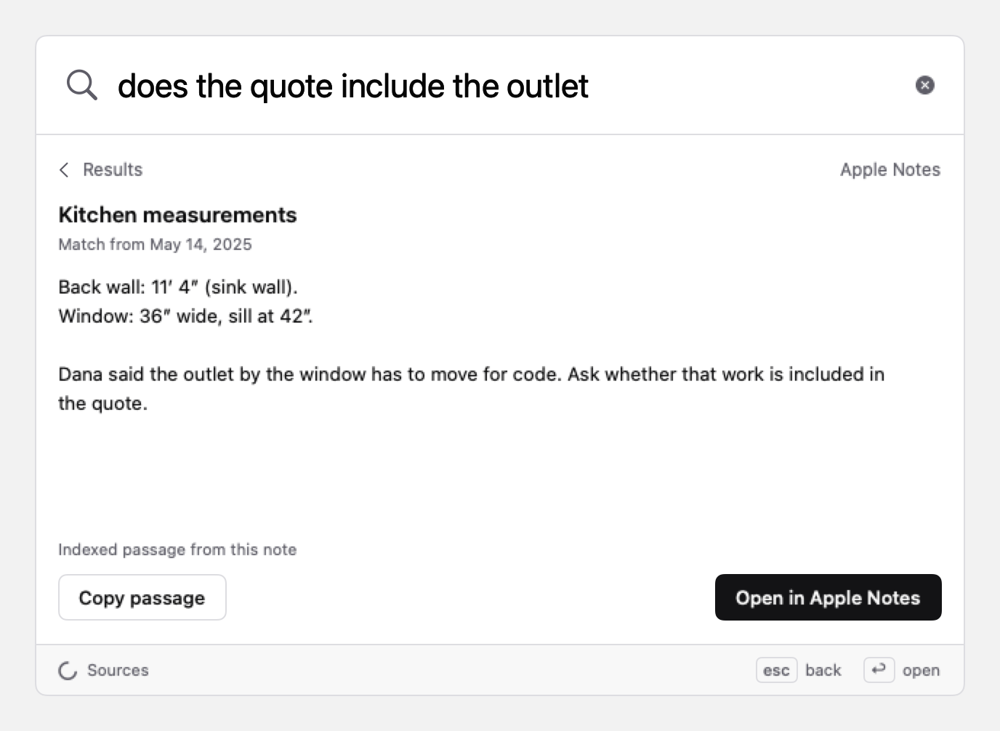
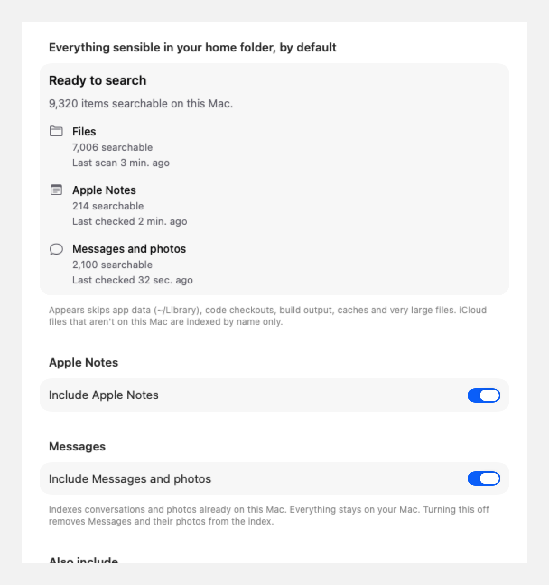

<p align="center">
  
</p>

<h1 align="center">Appears</h1>

<p align="center">
  <strong>Let your Mac do the searching.</strong><br>
  A menu bar app that notices what you're working on and quietly brings back<br>
  the messages, notes, photos and files you already have. Everything stays on your Mac.
</p>

<p align="center">
  <a href="https://appea.rs/app.dmg"><strong>Download for Mac</strong></a> ·
  <a href="https://appea.rs">appea.rs</a> ·
  <a href="#build-from-source">Build from source</a> ·
  <a href="#for-agents-mcp">MCP server</a>
</p>

<p align="center">
  <a href="https://github.com/seeARMS/appears/releases/latest"></a>
  <a href="https://github.com/seeARMS/appears/actions/workflows/ci.yml"></a>
  
  
  <a href="LICENSE"></a>
</p>

<p align="center">
  <picture>
    <source media="(prefers-color-scheme: dark)" srcset="docs/media/appears-dark.gif">
    
  </picture>
</p>

---

You're replying to an email about the kitchen remodel. Somewhere on your Mac is a photo of the contractor's quote, a note from the walkthrough, and a text from Dana about the outlet. You'd find them if you went looking, but you won't, because you've forgotten they exist.

Appears reads the window in front of you, works out what it's about, and finds what you already have on the subject. When it's confident, a small dot appears on its menu bar ring. Click it, or press <kbd>⇧</kbd><kbd>⌘</kbd><kbd>Space</kbd>, and they're there. No query, no notifications, no cloud.

## Features

<table>
  <tr>
    <td width="50%" valign="top">
      <picture>
        <source media="(prefers-color-scheme: dark)" srcset="docs/screenshots/related-panel-dark.png">
        
      </picture>
      <p><strong>Related, without asking.</strong> Up to ten results for whatever you're looking at, each with the line that matched and a confidence ring. It favours what you've forgotten over what you opened yesterday.</p>
    </td>
    <td width="50%" valign="top">
      <picture>
        <source media="(prefers-color-scheme: dark)" srcset="docs/screenshots/search-contacts-dark.png">
        
      </picture>
      <p><strong>Search by meaning.</strong> Press <kbd>⌃</kbd><kbd>⇧</kbd><kbd>Space</kbd> and describe what you remember. Text and images share one vector space, so "the quote for the kitchen" finds the photo of the quote.</p>
    </td>
  </tr>
  <tr>
    <td width="50%" valign="top">
      <picture>
        <source media="(prefers-color-scheme: dark)" srcset="docs/ux/note-preview-dark.png">
        
      </picture>
      <p><strong>Your files, Notes and Messages.</strong> Documents, PDFs, screenshots and photos in your home folder, plus Apple Notes and Messages with their photos. Preview a passage inline, copy it, or open the original.</p>
    </td>
    <td width="50%" valign="top">
      <picture>
        <source media="(prefers-color-scheme: dark)" srcset="docs/ux/source-health-dark.png">
        
      </picture>
      <p><strong>Before meetings, too.</strong> With Calendar access, Appears looks ten minutes before each meeting. And Sources shows exactly what's indexed, what's still waiting, and which permissions are missing.</p>
    </td>
  </tr>
</table>

## Private by construction

Appears reads your screen, so "trust us" isn't good enough. Each promise below is enforced by macOS or checked by the build, and you can verify each one yourself.

| Part | What it does | How it's kept off the network |
| --- | --- | --- |
| **`Appears.app`** | The menu bar, the panel, reading the front window through Accessibility | Has no networking code. `mac/scripts/check-no-network.sh` fails the build if the binary imports sockets, URLSession, Network.framework or CFNetwork streams. |
| **`AppearsEngine.xpc`** | Reading files, the model, the index, the journal | App Sandbox with **no network entitlement**, so macOS blocks every connection. Read-only access to your home folder and `/Volumes`. |
| **`AppearsDownloader.xpc`** | Downloads the pinned model once, during setup | Sandboxed with network.client only and **no access to your files or screen**. Every file must match its pinned size and SHA-256. |
| **Sparkle's Downloader** | App updates | Sparkle's own sandboxed XPC service. Feeds and DMGs must carry valid Ed25519 signatures. |

- **Nothing about your screen is stored.** What's on screen, and your calendar events, are read in memory and dropped. The journal of what you opened or dismissed keeps item ids, scores and a salted fingerprint, never text.
- **Sensitive windows are never read:** password managers, Keychain Access, System Settings, secure text fields, and private browser windows. Safari can't say whether a window is private, so ambient mode skips Safari unless you turn it on.
- **Silence is the default.** No notifications, no sounds, no pop-ups. A dot on the menu bar ring is the loudest it gets.
- **No analytics, telemetry or crash reporting**, in the app or on the site.

Check the engine's entitlements and the app's imports on any build:

```bash
codesign -d --entitlements - mac/build/DerivedData/Build/Products/Release/Appears.app/Contents/XPCServices/AppearsEngine.xpc
```

```bash
mac/scripts/check-no-network.sh mac/build/DerivedData/Build/Products/Release/Appears.app
```

<details>
<summary><strong>Why the app itself isn't sandboxed</strong></summary>

Apple doesn't allow the Accessibility API inside the App Sandbox, even after you grant the permission. So the part that reads the screen can't be sandboxed, and it can't sandbox itself either: a self-applied `sandbox_init` profile, even one that allows everything except IP networking, makes macOS refuse the process Accessibility, and on macOS 27 the built-in `no-network` profile kills it outright (both found 2026-10-15). That's why the app is kept small and free of networking code, and why everything that opens your files runs in the sandboxed engine instead: the code that parses PDFs, images and documents is exactly the code that should be locked down.

</details>

## Install

[Download the DMG](https://appea.rs/app.dmg) and drag Appears to Applications. It needs a Mac with Apple silicon running macOS 26 or later.

Setup asks for:

- **Accessibility** (required), to read the front window;
- **Full Disk Access** (optional), for Notes, Messages and their photos, and to avoid prompts for Desktop, Documents and Downloads;
- **Contacts** (optional), for names and photos in Messages results;
- **Calendar** (optional), to look ahead to meetings;
- **Screen Recording** (optional), to OCR a window that has no readable text, only when you ask.

The on-device model (about 914 MB) downloads in the background while you go through setup. After that, Appears works offline. Updates are checked once a day; you see the changelog and choose whether to install.

## How it works

1. **Context.** When the front window changes, the app reads its title, the document it shows, the field you're typing in, the selection and the visible text, in memory only. Browser URLs come from Apple Events (Safari, Chrome) or Accessibility (Firefox). For a meeting, the event stands in for a window, minus join links, dial-ins and passcodes.
2. **Index.** The engine embeds text, PDF pages and images with Google's [EmbeddingGemma 2](https://huggingface.co/google/embeddinggemma-2) on [MLX](https://github.com/ml-explore/mlx-swift), into one vector space, next to an FTS5 full-text index.
3. **Ranking.** Vector search and full-text search on names, numbers and rare words are fused by rank, then weighted toward things you haven't touched in months, away from the open document and its neighbours, and diversified so you don't get three near-copies.
4. **Confidence.** Each result gets a 0–1 score from how far it stands above the other candidates. A match counts for more when what you're writing asks your memory ("what was the wifi password again?").
5. **When to speak.** Appears looks after five seconds reading or a two-second pause in typing. It marks the ring only for a confident match (0.6 by default), at most once a minute, and never twice for the same item in the same document or conversation.

<details>
<summary><strong>The details</strong></summary>

#### What gets indexed

Everything sensible in your home folder (documents, PDFs, images and screenshots) plus Apple Notes and Messages, including photos already downloaded on this Mac. Messages are read directly and read-only from `~/Library/Messages/chat.db`. Each message is embedded with nearby conversation, and photos use the image model plus on-device OCR. It skips:

- `~/Library`, code checkouts (any folder with `.git`), package and build folders (`node_modules`, `dist`, `vendor`, `obj`…) and caches;
- coding agents' workspaces (`~/conductor`, `~/Documents/Codex`…);
- data dumps: a folder with more than 150 plain-text files directly in it;
- plain text over 2 MB, and boilerplate (LICENSE, CHANGELOG…);
- text that is mostly numbers, which is indexed by name only.

Settings has Include and Exclude lists. Added folders are watched immediately, including folders outside home and explicit includes inside otherwise skipped folders. Sources → Include Messages and photos is on by default; switching it off removes both from the index. New and edited messages are checked each minute; deletions, unsends and newly downloaded photos are reconciled at least every ten minutes, or immediately with "Look for new items now".

#### Ranking

- **Forgotten:** results are weighted toward what you haven't touched in months. Recent files rank lower. Messages have only a small age penalty (up to 15%), so yesterday's conversation can still answer today's question. The open document is excluded.
- **New:** what's in the same folder or repeats the window title counts less.
- **Varied:** results are diversified.
- **Photos:** when the window shows a picture (a photo open in Preview), the picture itself is the query. The engine uses the vector it indexed for that file, or embeds it then, keeping that vector in memory only. Any words in the window are blended in, except a title that is just the file's name.

#### The panel

Asking shows up to ten results in a scrolling list, with about five rows visible and the header and keyboard hints fixed. Every row shows a short source excerpt with matching terms emphasized, or a specific name match, with the date and PDF page below. A small Orbit outline fills with the result's confidence; hover or VoiceOver gives the exact value. Images show text only when a clean OCR phrase matches; otherwise the thumbnail is the evidence. <kbd>Space</kbd> previews Notes and Messages inline; files and photos use Quick Look.

#### Ambient timing

Typing cancels the reading timer, and short composed questions can search too. Unchanged text isn't searched again, and answers for an earlier draft are discarded. Signals are at least one minute apart, with no hourly cap; searches still run during that minute, and a one-shot timer revalidates the latest result when the gap expires. Ignoring the dot or closing the panel adds no penalty. Explicitly hiding an item suppresses it in that context without slowing other suggestions. "Log only" mode records what it would have shown, without showing it.

#### Meetings

With Calendar access, Appears looks once before each meeting, 10 minutes ahead by default. The event's title, invitees, location and notes stand in for a window. All-day events, ones you declined, and blocks with nobody else and nothing written in them are skipped. One timer waits for the next meeting; nothing polls.

#### Search

<kbd>⌃</kbd><kbd>⇧</kbd><kbd>Space</kbd>, "Search Appears…" from the ring's menu, or opening Appears from Finder or Spotlight opens a centered search window with up to 20 results. Messages show the strongest text match per conversation; photos stay separate, and distinct conversations are kept even when they have the same name. Use <kbd>↑</kbd>/<kbd>↓</kbd> to select, <kbd>Return</kbd> to open, <kbd>⌘</kbd><kbd>Return</kbd> to reveal in Finder, <kbd>⌘</kbd><kbd>Y</kbd> to preview, and <kbd>Esc</kbd> to close. Search needs no Accessibility or Screen Recording permission. Queries and results live only in memory and never enter the journal.

#### Measuring

The journal records each suggestion and what you did with it (opened, previewed, dragged out, dismissed, ignored). Settings → Activity and `appears stats` turn it into precision numbers.

#### Launch, sources and updates

- **Open at login** is in Settings → General, off until you turn it on.
- **Index & Sources…** in the menu shows readiness, counts per source, permissions, scan dates and live folder updates. Search stays usable while indexing continues.
- **Updates:** Sparkle checks once a day and never opens a window on its own. **Update…** in Settings shows the GitHub release's notes, rendered as native text without remote content. Models stay pinned to compatible app releases; a new pin downloads and verifies on the next launch.

</details>

## Build from source

You need Xcode 27 with its Metal toolchain, [XcodeGen](https://github.com/yonaskolb/XcodeGen), Node 24, and an Apple-issued code-signing identity (Apple Development or Developer ID). From the repository root:

```bash
npm run rebuild
```

No `npm install` is needed. This builds the current checkout in Release, verifies signatures, privacy boundaries and bundled licenses, replaces `/Applications/Appears.app`, and checks that it launches. If installing or launching fails, the previous app is restored. Settings, the index and the downloaded model stay where they are.

<details>
<summary><strong>Options and manual builds</strong></summary>

- `npm run rebuild -- --build-only` builds and verifies without installing or launching.
- `APPEARS_INSTALL_DIR="$HOME/Applications" npm run rebuild` installs per user.
- `APPEARS_SIGN_IDENTITY` picks a signing identity by full name or SHA-1 (from `security find-identity -v -p codesigning`). Otherwise the script reuses the installed app's certificate, then a single Developer ID Application identity, then Apple Development. It never creates certificates. Self-signed certificates have no Team ID and fail hardened runtime's library validation when loading Sparkle.
- Keep the identity and install path stable across rebuilds so macOS permissions stick.
- Local builds without a Sparkle public key show update checks as unavailable.

To build by hand:

```bash
DEVELOPER_DIR=/Applications/Xcode.app/Contents/Developer mac/scripts/build-sparkle.sh
```

```bash
cd mac && xcodegen && xcodebuild -project Appears.xcodeproj -scheme Appears -configuration Release -derivedDataPath build/DerivedData ARCHS=arm64 ONLY_ACTIVE_ARCH=YES build
```

Put your team (`DEVELOPMENT_TEAM = …`) and identity (`CODE_SIGN_IDENTITY = Apple Development`) in `mac/Config/Local.xcconfig` (git-ignored) first. Use Release: MLX runs unoptimized in Debug.

For offline development, prepare and seed the model cache once (`mac/Models/` is git-ignored):

```bash
mac/scripts/fetch-model.sh
```

```bash
python3 -I mac/scripts/install-local-model.py
```

The first index takes a while and pauses in Low Power Mode; the menu bar ring has a wider gap while it works. On a test Mac with about 11,000 files after the skip rules, documents and PDFs ran at about 2.7 a second, scanned PDFs took 10–17 seconds each for OCR, and images ran at about 13 a second. Watch it with:

```bash
log stream --level info --predicate 'subsystem == "rs.appea.appears"'
```

Paths in the log are redacted.

Typed search also reports preparation, model queue wait, model execution, vector matching, full-text matching, ranking, and total durations in the `search` log category. These entries contain only timings and whether the request completed, failed, or was cancelled; they never contain queries, source text, paths, or result identifiers. Search replies include the same timings in memory. To inspect them locally:

```bash
log stream --level info --predicate 'subsystem == "rs.appea.appears" AND category == "search"'
```

Search keeps its 180 ms typing debounce. A new query cancels the previous request through XPC and replaces queued model work. The shared model finishes its current forward safely, then serves waiting queries ahead of indexing batches and individual images. Filesystem walks run separately from the indexing actor, repeated rescans share one active walk and one pending follow-up, and source-setting changes invalidate older scans and searches. Results arrive after semantic matching completes.

</details>

### Try it on made-up data

[`demo/`](demo) is an invented home folder: a kitchen remodel with a contractor, a dental claim, a Lisbon trip, a cabin's wifi card, and about 120 distractors. Nothing in it is real.

```bash
python3 -I demo/set-ages.py
```

```bash
open -n /Applications/Appears.app --args -demo "$PWD/demo/files"
```

`-demo` keeps a separate index. Then open a text file in TextEdit containing "Hi Dana, can you confirm the quote covers moving the outlet?" and press <kbd>⇧</kbd><kbd>⌘</kbd><kbd>Space</kbd>.

- `-ask "<text>"` runs one ask with scripted text once indexing finishes, without needing Accessibility.
- `-search "the quote for the kitchen"` opens semantic search on the demo.
- `-event "<title>"` stands in a made-up meeting for your calendar, which is then never read. Add `-event-with "Name <email>; …"`, `-event-location`, `-event-notes` and `-event-in <seconds>`.

```bash
open -n /Applications/Appears.app --args -demo "$PWD/demo/files" -event "Kitchen walkthrough with Dana Ruiz" -event-with "Dana Ruiz <dana@ruizdaughters.example>"
```

## Tests and the eval

```bash
cd mac/Packages/AppearsKit && DEVELOPER_DIR=/Applications/Xcode.app/Contents/Developer swift test
```

The model's tests, and `appears mcp` run as its own process on the demo (they skip without the model):

```bash
cd mac/Packages/AppearsModel && xcodebuild test -scheme AppearsModel-Package -destination 'platform=macOS' -derivedDataPath ../../build/ModelDerivedData
```

Build the CLI and run the eval:

```bash
cd mac/Packages/AppearsModel && xcodebuild -scheme appears -destination 'platform=macOS' -derivedDataPath ../../build/ModelDerivedData -configuration Release build
```

```bash
mac/build/ModelDerivedData/Build/Products/Release/appears eval --verbose
```

`appears eval` indexes `demo/files` in a temporary folder and scores [`demo/scenarios.json`](demo/scenarios.json): recall@3, MRR, ambient hits (right and confident), false surfaces on negative scenarios (where the right answer is silence), and whether anything recent was shown.

| Date | Scenarios | recall@3 | MRR | Ambient hits | False surfaces |
| --- | --- | --- | --- | --- | --- |
| 2026-10-16 | 23 positive, 22 negative | 0.99 | 1.00 | 23/23 | 0/22 |

The confidence weights were fitted to these same scenarios, so treat the eval as a regression check, not a benchmark. Add scenarios before trusting the numbers.

<details>
<summary><strong>More checks and tools</strong></summary>

- `mac/scripts/test-updates.sh` checks update preferences, quiet discoveries and release validation in a separate fixture app, and renders the update settings and changelog in light and dark.
- `DEVELOPER_DIR=/Applications/Xcode.app/Contents/Developer python3 -I -m unittest discover -s mac/scripts/tests` verifies GitHub release metadata and real signatures, including tampering and mismatched keys. Both use made-up data and throwaway test keys.
- `mac/scripts/test-model.sh` runs inference tests and the eval on an Apple silicon Mac.
- `appears related "<text>"` and `appears index [--root DIR]` work on the CLI's own index in `~/Library/Application Support/rs.appea.appears.cli` (or `--data DIR`). `--no-messages` skips conversations.
- `appears stats --data <engine data folder>` prints the journal's numbers.
- `appears-context` prints what Accessibility reads from the front window every 3 seconds, for checking coverage app by app.
- `appears-snapshots` (run from the repo root) renders the panel, search and onboarding, light and dark, to `mac/build/snapshots`. Its controlled search backend checks debounce, replacement before an old reply, stale replies, clear/reopen, selection and source changes. An anonymous XPC fixture also checks cancellation messages and reply races without starting the installed engine or reading user files.

</details>

## For agents (MCP)

`appears mcp` is a [Model Context Protocol](https://modelcontextprotocol.io) server on stdio. Agents on your Mac (Claude Code, Claude desktop, Codex) can ask it what you already have about something: "what do I have about the Lisbon trip", "find the wifi card from the cabin".

```bash
claude mcp add appears -- "$PWD/mac/build/ModelDerivedData/Build/Products/Release/appears" mcp
```

- **Tools,** both read-only:
  - `related`: `text` (required), `limit` (default 5, at most 20) and `prefer_forgotten` (default off). Each result has its path, title, kind, a one-line reason, the matching snippet, dates, the page for PDFs, and a 0–1 confidence.
  - `related_to_file`: `path`, with the same options. It searches with that file's stored vectors, so it needs no model call.
- **It does nothing unless you set it up.** Neither the app nor the engine starts it.
- **Appears sends nothing anywhere, but the agent you connect may.** `appears mcp` has no networking code, reads the index read-only, stores nothing and logs no questions or results. But what it answers becomes part of the agent's conversation, and the agent may send that to its model provider: paths, snippets, and possibly the password on a photo of a wifi card. Connect only agents you'd show those files to.

<details>
<summary><strong>Setup for other agents, the demo, and how it ranks</strong></summary>

For Claude desktop, in `~/Library/Application Support/Claude/claude_desktop_config.json`:

```json
{
  "mcpServers": {
    "appears": {
      "command": "/path/to/appears/mac/build/ModelDerivedData/Build/Products/Release/appears",
      "args": ["mcp"]
    }
  }
}
```

For Codex, in `~/.codex/config.toml`:

```toml
[mcp_servers.appears]
command = "/path/to/appears/mac/build/ModelDerivedData/Build/Products/Release/appears"
args = ["mcp"]
```

By default it opens the app's own index read-only beside the running engine, so answers keep up as the app indexes. The index lives in the engine's sandbox container, which macOS doesn't let other apps read, so the app running the agent (Terminal, iTerm, Claude, Codex) needs Full Disk Access; otherwise every answer is an error saying so. `--demo` reads the app's `-demo` index, `--data DIR` any index made with `appears index --data DIR`, and `--model` picks a model folder.

To try it on the demo without the app:

```bash
mac/build/ModelDerivedData/Build/Products/Release/appears index --root demo/files --data /tmp/appears-demo --no-notes
```

```bash
echo '{"jsonrpc":"2.0","id":1,"method":"tools/call","params":{"name":"related","arguments":{"text":"what is the wifi password at the cabin"}}}' | mac/build/ModelDerivedData/Build/Products/Release/appears mcp --data /tmp/appears-demo
```

Ranking is the app's, without the "forgotten" weighting, because an agent asking outright should get yesterday's file as readily as last year's; `prefer_forgotten: true` ranks as the menu bar does. Exclusions and "Never show this" apply exactly as in the app. The model loads on the first question (a couple of seconds); after that a question takes about 50 ms on the demo. It speaks MCP 2026-07-28 (stateless) and the `initialize` handshake from 2025-11-25 back to 2024-11-05.

</details>

## Repository

```
mac/
  App/                    the menu bar app (AppKit + SwiftUI): status item, panel, search, settings, onboarding
  Engine/                 the sandboxed XPC service: files, model, index, journal
  Downloader/             the sandboxed first-run model downloader
  Packages/AppearsKit/    core logic; builds and tests with the Command Line Tools
    AppearsCore/          sources, extractors, Notes and Messages readers, index, ranking, journal, surface policy
    AppearsContext/       Accessibility reader, browser URLs, exclusions, OCR fallback
    AppearsMCP/           `appears mcp`, read-only on the index
  Packages/AppearsModel/  EmbeddingGemma 2 on MLX, and the `appears` CLI
  Tools/                  appears-context, appears-snapshots
  scripts/                model download and preparation, privacy checks, release build
  project.yml             XcodeGen spec (the Xcode project is generated, not committed)
web/                      appea.rs: one static Astro page behind a small Worker
demo/                     a made-up home folder and eval scenarios
brand/                    the Orbit mark and app icon
docs/                     screenshots, media and the release guide
```

## Roadmap

- **Calibration** learned from the journal, instead of weights set by hand from the eval.
- **Notes attachments** (scans and photos inside notes). Note text is indexed today.
- **A Homebrew cask**, and verifying an installed release updating to the next one.
- **`appears mcp` without a checkout or Full Disk Access**, by shipping the CLI inside the app under its Team ID.
- **Later:** voice memos and audio, video, Mail, and Photos.

## Contributing

Bug reports, Accessibility coverage fixes for specific apps, better file reading and new synthetic eval scenarios are all welcome. Read [CONTRIBUTING.md](CONTRIBUTING.md) first, and open an issue before a large feature or anything that changes when Appears speaks up. Everyone taking part follows the [Code of Conduct](CODE_OF_CONDUCT.md).

Report vulnerabilities and private-data exposures privately, as described in [SECURITY.md](SECURITY.md), never in a public issue. Maintainers: see [docs/releasing.md](docs/releasing.md).

## License

Appears is [MIT licensed](LICENSE). Upstream code and model files keep their own licenses:

- the vendored model runtime's notices are in [`mac/Packages/AppearsModel/ThirdParty/EmbeddingGemma2Swift`](mac/Packages/AppearsModel/ThirdParty/EmbeddingGemma2Swift);
- `mac/scripts/bundle-licenses.py` copies this project's license, Sparkle's, and the license files of every resolved Swift dependency into `Appears.app/Contents/Resources/Licenses`, with a manifest that CI and the release build verify;
- the downloaded model carries Google DeepMind's `LICENSE.txt`, a `NOTICE.txt` with the source revision, and `appears-model.json` with provenance and checksums.

Made by [Colin Armstrong](https://armstr.ng).
